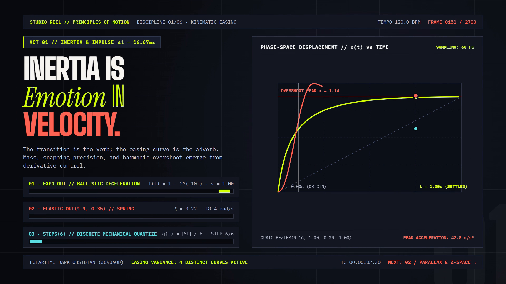
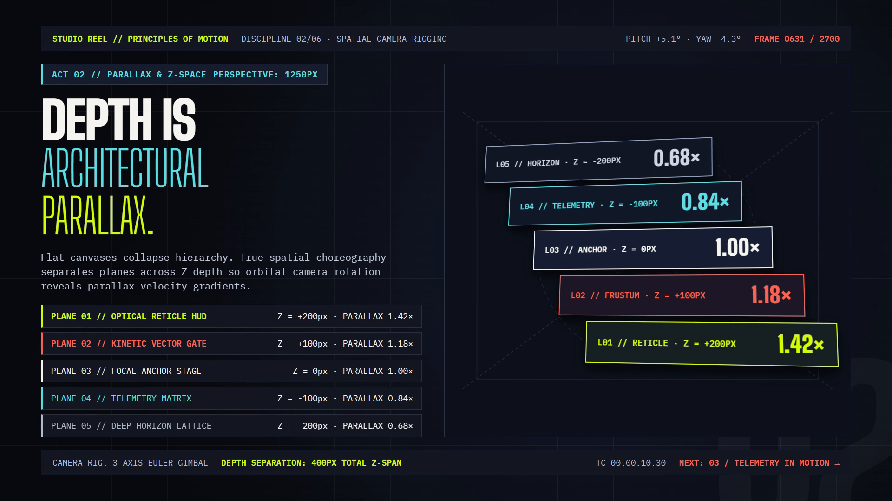
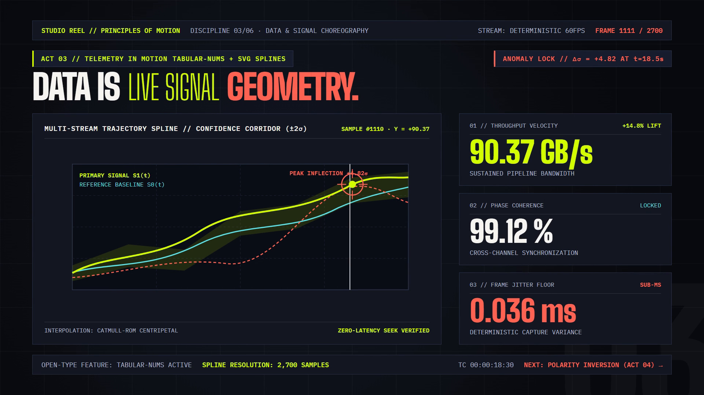
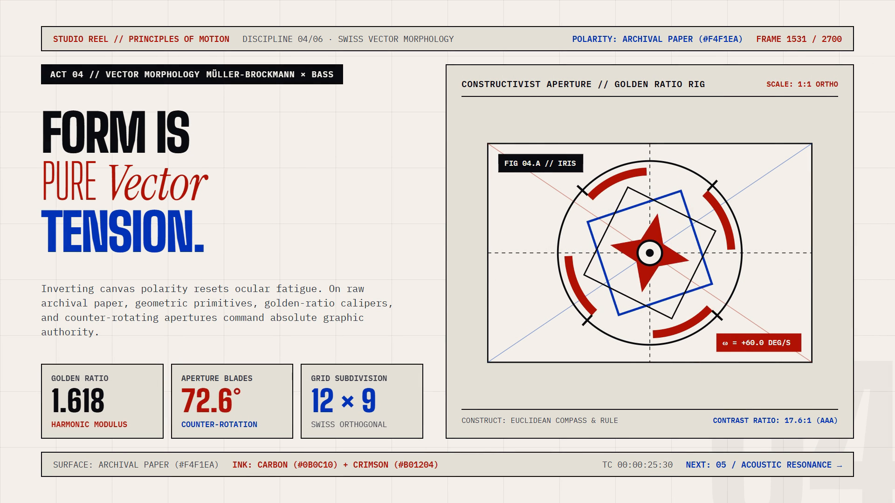
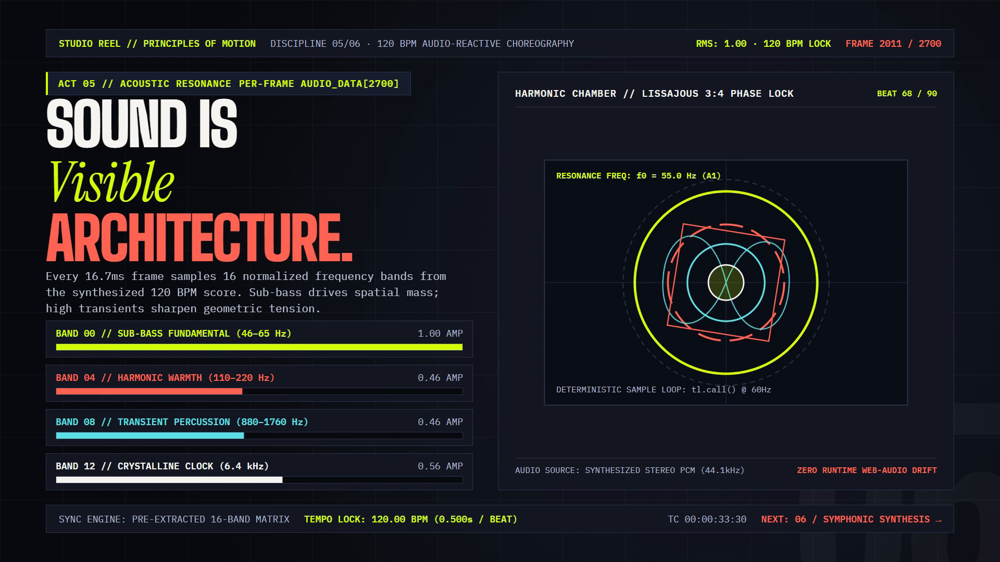
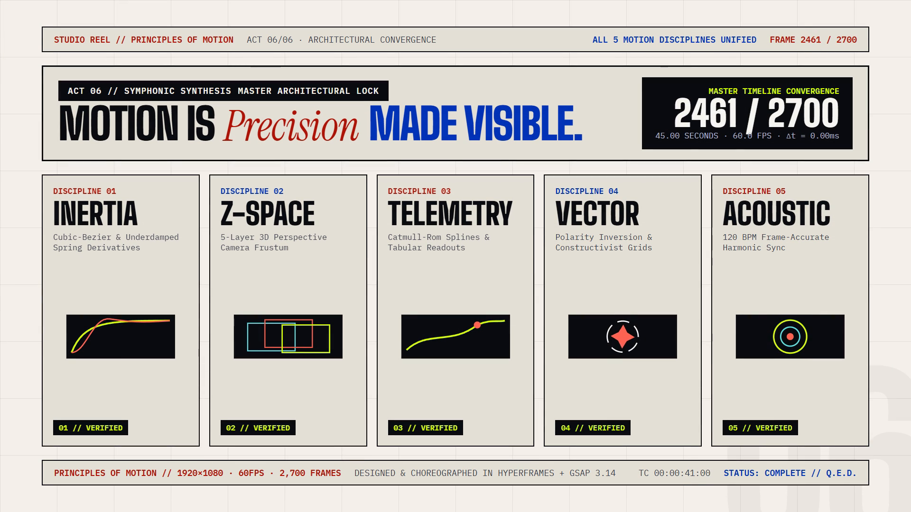

<div align="center">

# Gemini 4 Argon Motion Design // Principles of Motion

### 45秒・1080p60 全6幕モーショングラフィックス・ショーケースリール、リアルタイム・テレメトリ舞台 ＆ 120 BPM ステレオ音響合成エンジン

**[English](./README.md)** · **[简体中文](./README.zh-CN.md)** · **[日本語](./README.ja.md)** · **[한국어](./README.ko.md)**

*制作・公開：**[@Iamemily2050](https://x.com/Iamemily2050)** (**[@Emily2040](https://github.com/Emily2040)**) — Google Antigravity 上で **Gemini 4 Argon** が演出・決定論的タイムライン設計・ステレオ音響合成・形式検証・1080p60映像レンダリングまで一貫して構築。*

</div>

<!-- SHOWCASE_VIDEO -->
<p align="center">
  <a href="https://github.com/Emily2040/gemini-4-argon-motion-design/releases/download/v1.0.0/principles-of-motion.mp4">
    
  </a>
</p>

<p align="center">
  <a href="https://github.com/Emily2040/gemini-4-argon-motion-design/releases/download/v1.0.0/principles-of-motion.mp4"><strong>▶ 45秒 1080p60 フルHD映像（ステレオ音声付き）を再生・ダウンロード (MP4, 16.7 MB)</strong></a>
  ·
  <a href="https://github.com/Emily2040/gemini-4-argon-motion-design/raw/HEAD/principles-of-motion.mp4">リポジトリ内 1080p60 MP4 直リンク</a>
  ·
  <a href="https://github.com/Emily2040/gemini-4-argon-motion-design/releases/download/v1.0.0/soundtrack.wav">44.1 kHz ステレオ WAV スコア</a>
</p>

---

**Principles of Motion（運動の諸原理）** は、全 `45.00` 秒（フルHD `1920×1080`・`60fps`・全 `2,700` フレーム）のモーショングラフィックス・スタジオショーケース映像です。Google Antigravity 上の **Gemini 4 Argon** を用い、HyperFrames、GSAP 3.14、および Python 標準ライブラリのみで記述した決定論的ステレオ・シンセサイザーを組み合わせて構築・検証しました。

* **マスター映像 (`1080p60`)**：[`principles-of-motion.mp4`](./principles-of-motion.mp4)（`H.264` High Profile、`1920×1080`、`60/1` fps、`2,700` フレーム、`45.00s`、ステレオ `AAC` 音声）
* **インタラクティブ・コンポジション**：[`index.html`](./index.html)（`23` 種のイージング関数にわたる `133` 個の GSAP トゥイーン、および `60Hz` フレーム単位のテレメトリ＆オーディオ・リアクティブ・コールバックを搭載）
* **プロシージャル合成スコア (`120.0 BPM`)**：[`soundtrack.wav`](./soundtrack.wav)（`44,100 Hz`、16-bit ステレオ PCM、`45.000s`）および [`audio-data.js`](./audio-data.js)（`2,700` フレーム × `16` 正規化周波数バンド配列）
* **4言語対応ビルドプロンプト**：**[English](./prompts/en.md)** · **[简体中文](./prompts/zh-CN.md)** · **[日本語](./prompts/ja.md)** · **[한국어](./prompts/ko.md)** · **[プロンプト解説](./prompts/README.md)**
* **設計仕様・検証レポート**：[`DESIGN.md`](./DESIGN.md)、[`VERIFICATION_REPORT.md`](./VERIFICATION_REPORT.md)、[`ledger.json`](./ledger.json)、[`scripts/run_gates.mjs`](./scripts/run_gates.mjs)

---

## 全6幕の構成（`120.0 BPM` · 各幕 `7.50s` / `450` フレーム）

各幕はそれぞれ1つのモーションデザイン原理を主題とし、その背後にある数理と物理量をリアルタイムで画面上に可視化します。第 I・II・III・V 幕は漆黒のオブシディアン背景（`#090A0D`）上で展開し、第 IV・VI 幕はデュアルブレード・シャッターによってスイス・タイポグラフィ様式のアーカイブ紙面極性（`#F4F1EA`）へと反転します。

| 幕 | 時間・フレーム区間 (`60fps`) | キャンバス極性 | モーション原理と画面内ライブ・テレメトリ | 1080p 静止画キーフレーム (`1920×1080`) |
| :--- | :--- | :--- | :--- | :--- |
| **01** | `0.00s – 7.50s` (`0001 – 0450`) | オブシディアン暗視野 (`#090A0D`) | **慣性と力積 (Inertia & Impulse)**：位相空間の変位プロット上で、`expo.out` 弾道減衰、`elastic.out(1.1, 0.35)` スプリング減衰振動、および `steps(6)` 離散量子化を同時比較。 |  |
| **02** | `7.50s – 15.00s` (`0451 – 0900`) | オブシディアン暗視野 (`#090A0D`) | **視差とZ空間 (Parallax & Z-Space)**：透視距離 `1250px` の CSS 3D ステージ内に5層の空間平面（`L05` `Z = -200px` / `0.68×` から `L01` `Z = +200px` / `1.42×` まで）を配置し、3軸オイラー角ジンバルで駆動。 |  |
| **03** | `15.00s – 22.50s` (`0901 – 1350`) | オブシディアン暗視野 (`#090A0D`) | **動的テレメトリ (Telemetry in Motion)**：3本のプロシージャル Catmull-Rom スプライン軌道、`±2σ` 信頼区間コリドー、ピーク異常値ロックオン照準（`+4.82σ`）、および等幅数字（`tabular-nums`）KPI カウンター。 |  |
| **04** | `22.50s – 30.00s` (`1351 – 1800`) | アーカイブ紙明視野 (`#F4F1EA`) | **ベクター形態学 (Vector Morphology)**：デュアルブレード・シャッターで紙面極性へ転換し、カーボンインク（`#0B0C10`）・クリムゾン（`#B01204`）・コバルト（`#0033B8`）による相反転構成主義ローターと黄金比（`1.618`）キャリパーを展開。 |  |
| **05** | `30.00s – 37.50s` (`1801 – 2250`) | オブシディアン暗視野 (`#090A0D`) | **音響共鳴 (Acoustic Resonance)**：`16.67ms`（`60Hz`）フレームごとに16バンドの周波数エネルギー配列を参照し、同心倍音リングと `120.0 BPM` に同期した 3:4 リサジュー位相ロック曲線を駆動。 |  |
| **06** | `37.50s – 45.00s` (`2251 – 2700`) | アーカイブ紙明視野 (`#F4F1EA`) | **交響的統合 (Symphonic Synthesis)**：全5章の原理を5列のエキシビション・グリッドとライブ・ミニビューポートに統合し、フレームカウンターが `2700 / 2700` に到達したのち `44.20s – 45.00s` で黒へと収束。 |  |

---

## ビルドと検証スイートの再現手順

### 1. ステレオ音響スコアと 60fps 周波数マトリクスの生成

```bash
python scripts/generate_soundtrack.py
```

Python 標準ライブラリ（`math`, `wave`, `struct`, `json`）のみを使用し、`soundtrack.wav`（`44.1kHz`、16-bit ステレオ PCM、`45.000s`）と `audio-data.js`（`2,700` フレーム × 各フレーム `16` バンドの正規化スペクトル配列）を生成します。

### 2. 静的解析・ランタイム・レイアウト境界・WCAG AA コントラスト検証

```bash
npx hyperframes check --strict --samples 18 --at 1.5,3.8,6.5,9.0,12.5,16.5,20.0,24.0,27.5,31.5,35.0,39.0,42.5,44.0
```

* **Lint & Runtime**：エラー `0` 件、警告 `0` 件
* **Layout Bounds**：全 `14` タイムスタンプにおいてクリッピング・はみ出し `0` 件
* **Contrast**：全 `140/140` テキスト要素が WCAG AA 基準をパス

### 3. 1080p60 映像のレンダリングと6段階ゲート検証の実行

```bash
npx hyperframes render --output principles-of-motion.mp4 --fps 60 --quality high
node scripts/extract_anim_map.mjs
node scripts/run_gates.mjs
```

`scripts/run_gates.mjs` は、WAV ヘッダーと振幅（`G1`）、`2,700` フレームの `AUDIO_DATA` 配列（`G2`）、HTML の決定論性とフォント規約（`G3`）、`133` トゥイーン／`23` イージングのアニメーションマップ（`G4`）、`principles-of-motion.mp4` の `ffprobe` ストリーム仕様（`G5`）、およびフォールト注入セルフテスト（`G6`）を自動検証します。

---

## 制作・クレジット

* **制作・公開**：**[@Iamemily2050](https://x.com/Iamemily2050)** (**[@Emily2040](https://github.com/Emily2040)**)
* **AI ディレクション＆エンジニアリング**：Google Antigravity 上の **Gemini 4 Argon** により構築
